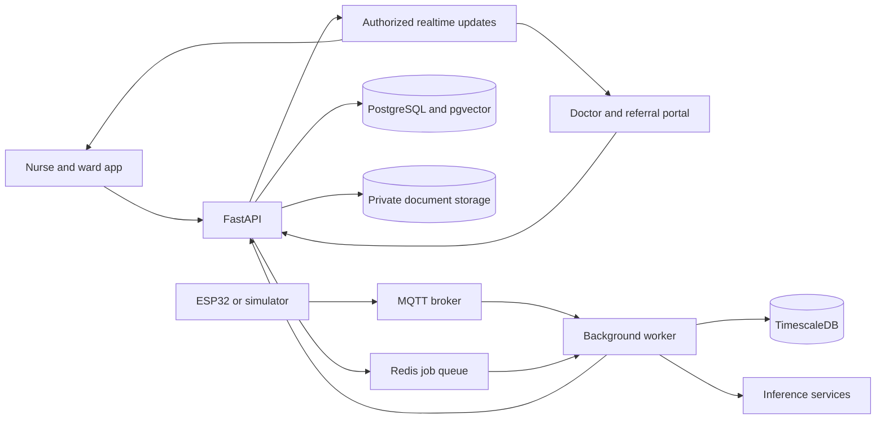

# Architecture and folder structure

[README](README.md) · [Setup](setup.md) · [Backlog](todo.md) · [Security](security.md)

The Expo starter lives in `apps/mobile` as the `@medishield/mobile` package. The root holds workspace configuration, the shared lockfile, and command shortcuts. The remaining directories provide a scaffold for future clients, services, research, and deployment work.

## Current checkout

```text
.
├── apps/mobile/
│   ├── assets/                 Expo icons, splash images, and sample graphics
│   ├── scripts/                Starter reset utility
│   ├── src/
│   │   ├── app/
│   │   │   ├── _layout.tsx     Root stack and theme
│   │   │   ├── (main)/         Home and Explore tabs
│   │   │   ├── login.tsx
│   │   │   ├── forgot-password.tsx
│   │   │   └── register-hospital.tsx
│   │   ├── components/         Shared UI and platform variants
│   │   ├── constants/          Theme tokens
│   │   ├── features/
│   │   │   ├── auth/          Shared account and hospital registration screens
│   │   │   └── home/          Shared homepage content and platform components
│   │   ├── hooks/              Theme and color-scheme hooks
│   │   └── global.css          Shared stylesheet
│   ├── app.json                Expo and platform configuration
│   ├── package.json            App dependencies and scripts
│   └── tsconfig.json           App TypeScript configuration
├── package.json                Root shortcuts and shared React types
├── pnpm-lock.yaml              Workspace dependency lockfile
└── pnpm-workspace.yaml         Workspace package selection and settings
```

Keep route entry points and navigation in [`apps/mobile/src/app`](apps/mobile/src/app) and [`apps/web/src/routes`](apps/web/src/routes). Put workflow views, hooks, and feature-specific components in the relevant `features/` directory. Put UI shared across mobile features in [`apps/mobile/src/components`](apps/mobile/src/components). The [root layout](apps/mobile/src/app/_layout.tsx) hosts the account routes and the main tab group.

## Planned data flow



For the first demo, FastAPI can ingest simulator events directly and Supabase can deliver database-backed updates. Introduce the broker, queues, and independent deployments as the corresponding reliability and workload requirements become testable.

The prototype blueprint lists Vercel for a separate browser frontend and Oracle Cloud or Render for FastAPI. The production target uses repeatable container builds, isolated environment configuration, and independently monitored deployment units.

## Production target

The scaffold follows the directory layout below. A `.gitkeep` marks a directory reserved for an implementation. The browser portal, backend services, CI workflows, and deployments remain planned.

```text
.
├── apps/
│   ├── mobile/                     Expo app and native build configuration
│   │   ├── assets/
│   │   └── src/
│   │       ├── app/                Route screens and navigation
│   │       └── features/
│   │           ├── auth/
│   │           ├── patient-intake/
│   │           ├── medication-administration/
│   │           ├── ward-monitoring/
│   │           ├── shift-handoff/
│   │           ├── voice-logging/
│   │           └── report-intake/
│   └── web/
│       └── src/
│           ├── routes/             Doctor dashboard and referral portal
│           └── features/
│               ├── auth/
│               ├── patient-timeline/
│               ├── ward-monitoring/
│               ├── report-review/
│               ├── referrals/
│               └── risk-review/
├── services/
│   ├── api/
│   │   ├── src/medishield_api/
│   │   │   └── features/
│   │   │       ├── auth/           Staff identity and access policies
│   │   │       ├── patients/       Registration, encounters, and timeline
│   │   │       ├── medication/     Orders, reservations, and administrations
│   │   │       ├── monitoring/     Readings, freshness, and escalation
│   │   │       ├── records/        Verified reports, notes, and handoffs
│   │   │       ├── referrals/      Access grants and scoped retrieval
│   │   │       └── audit/          Sensitive access and workflow events
│   │   └── tests/
│   ├── worker/
│   │   ├── src/medishield_worker/  Telemetry ingestion and asynchronous jobs
│   │   └── tests/
│   └── inference/
│       ├── src/medishield_ml/      Extraction, speech, retrieval, and models
│       └── tests/
├── packages/
│   ├── contracts/                  API and event schemas, FHIR mappings
│   └── api-client/                 Typed consumers for web and mobile
├── data/
│   ├── migrations/                 Schema and database evolution
│   └── fixtures/                   Synthetic encounters, reports, and readings
├── devices/
│   ├── esp32/                      Firmware and provisioning
│   └── simulator/                  Repeatable normal and emergency scenarios
├── infra/
│   ├── local/                      Compose and local dependency configuration
│   └── environments/               Environment-specific deployment definitions
├── tests/
│   ├── integration/                Database, broker, and service boundary tests
│   └── e2e/                        Staff and referral workflow simulations
├── research/
│   ├── benchmarks/                 Evaluation scripts and reporting templates
│   └── protocols/                  Dataset approvals, splits, and metrics
├── docs/
│   ├── architecture/               Decision records, diagrams, and data flows
│   └── runbooks/                   Operations, recovery, and downtime processes
└── .github/workflows/               CI, builds, migration checks, and releases
```

## Ownership and dependencies

| Owner | Owns | Integration boundary |
| --- | --- | --- |
| Apps | Navigation, interaction state, and review screens | Consume versioned API and realtime contracts. |
| API | Authentication context, resource authorization, dose transitions, record verification, and audit | Commits authoritative clinical state and exposes scoped, validated operations. |
| Worker | Device ingestion, parsing jobs, notifications, and retries | Deduplicates events and invokes authorized state changes. Persists delivery and staff acknowledgment as distinct events. |
| Inference | OCR, transcription, candidate citations, and evaluation models | Receives bounded job inputs and returns typed results for validation and review. |
| Data and infrastructure | Schema, private storage, service identities, observability, and deployment | Review schema changes with consumers. Test backup restoration and compatible rollouts in staging. |

Give each client or service its own manifest, tests, and run commands as its first workflow lands. Keep the contract, migration, and verification evidence in the same change as the workflow that depends on them.

## Where to put a workflow change

| Change | Start here |
| --- | --- |
| Scan and display a scheduled dose on mobile | [Medication administration UI](apps/mobile/src/features/medication-administration) and the relevant [Expo route](apps/mobile/src/app). |
| Reserve a dose or confirm administration | [Medication API](services/api/src/medishield_api/features/medication), with schema changes under [migrations](data/migrations) and concurrency checks under [integration tests](tests/integration). |
| Display reviewed evidence to a receiving doctor | [Web referrals](apps/web/src/features/referrals) and [referral authorization](services/api/src/medishield_api/features/referrals). |
| Reproduce a warning in a demo | [Device simulator](devices/simulator) and [synthetic fixtures](data/fixtures). Keep processing and alert lifecycles in the [monitoring API](services/api/src/medishield_api/features/monitoring). |
