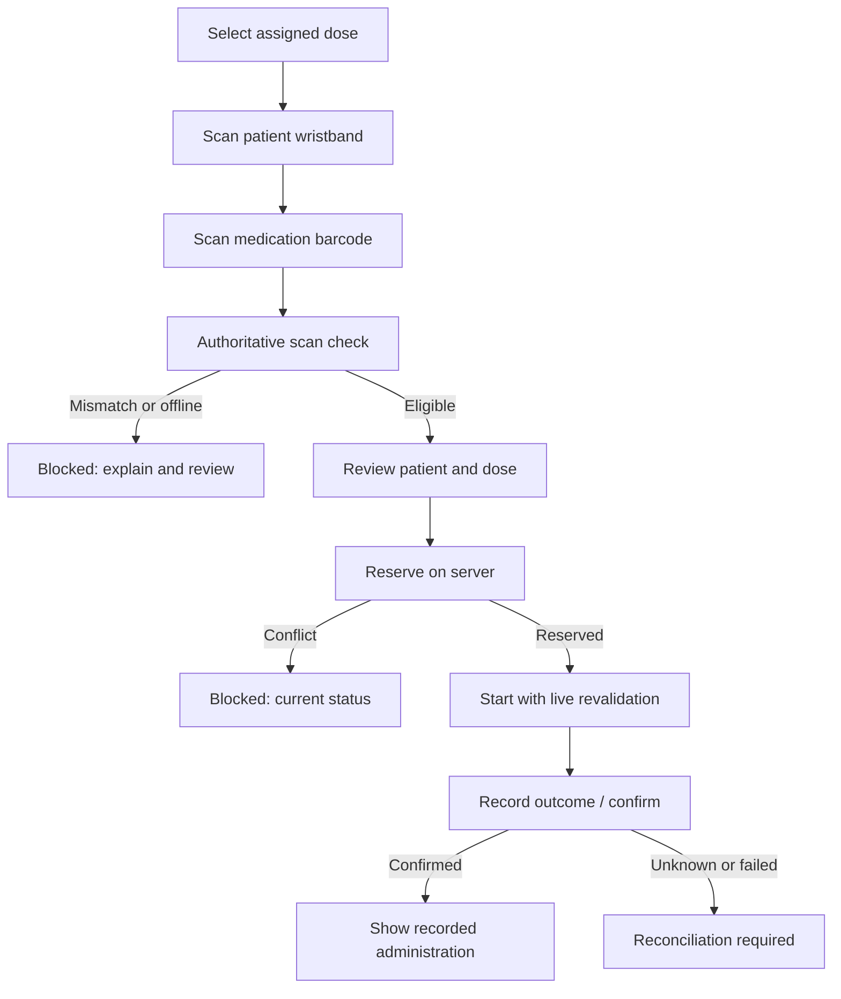

# MediShield AI — UI/UX Theme & Design System

> **Design direction:** Premium clinical healthcare · Emerald · Geist · Light & Dark · Collapsible web sidebar · Native mobile experience
>
> **Version:** 1.0 | **Status:** Proposed design specification | **Scope:** All web portals, nurse mobile application, shared components and clinical research interfaces

**Design motto:** Clear information. Confident navigation. Safer workflows.

This document is the single design reference for MediShield AI developers, designers and AI coding agents. Follow it when creating a new screen or changing an existing screen. It defines what the interface should look like, how it should behave, and how it should represent clinical information safely.

The feature scope follows [README.md](README.md) and [implementation_plan_v2.md](implementation_plan_v2.md), especially the role matrix and client application implementation in section 8 of the plan. Colors, layout sizes, components and interaction details below are new design decisions, not evidence of an implemented interface. The platform is an academic prototype; use synthetic data and do not imply clinical validation.

## Table of Contents

1. [Design principles](#1-design-principles)
2. [Brand identity](#2-brand-identity)
3. [Color system](#3-color-system)
4. [Typography](#4-typography)
5. [Spacing, shape and elevation](#5-spacing-shape-and-elevation)
6. [Responsive layout](#6-responsive-layout)
7. [Web application shell](#7-web-application-shell)
8. [Native mobile design](#8-native-mobile-design)
9. [Shared component library](#9-shared-component-library)
10. [Application routes and navigation](#10-application-routes-and-navigation)
11. [Authentication and onboarding](#11-authentication-and-onboarding)
12. [Super Admin workspace](#12-super-admin-workspace)
13. [Hospital Admin workspace](#13-hospital-admin-workspace)
14. [Reception and ward operations](#14-reception-and-ward-operations)
15. [Doctor workspace](#15-doctor-workspace)
16. [Nurse workspace and medication safety](#16-nurse-workspace-and-medication-safety)
17. [IoT monitoring and alerts](#17-iot-monitoring-and-alerts)
18. [Lab reports and OCR](#18-lab-reports-and-ocr)
19. [Voice logging and shift handoff](#19-voice-logging-and-shift-handoff)
20. [Patient and caregiver portal](#20-patient-and-caregiver-portal)
21. [Referral and Clinical RAG](#21-referral-and-clinical-rag)
22. [AI research interfaces](#22-ai-research-interfaces)
23. [Interaction, feedback and motion](#23-interaction-feedback-and-motion)
24. [Accessibility, language and privacy](#24-accessibility-language-and-privacy)
25. [Web implementation](#25-web-implementation)
26. [React Native implementation](#26-react-native-implementation)
27. [Implementation order and quality gates](#27-implementation-order-and-quality-gates)
28. [Instructions for AI coding agents](#28-instructions-for-ai-coding-agents)

---

## 1. Design principles

The product must feel like a calm, modern hospital workspace rather than a consumer fitness app or a generic admin template.

| Principle | What to do |
| --- | --- |
| Clinical clarity | Prioritize patient identity, tasks, timestamps, sources and warnings over decoration. |
| Premium simplicity | Use clean alignment, fine borders, carefully selected typography and generous but purposeful space. |
| Consistent behavior | Use one button system, one form system, one status vocabulary and predictable navigation. |
| Role-based focus | Show the tools each role needs. Keep clinical information outside administrative contexts unless explicitly authorized. |
| Fast everyday tasks | Keep frequently used actions easy to reach, particularly on mobile. |
| Visible uncertainty | Show missing, stale, unverified, offline and uncertain data as different states. |
| Accessible by default | Use text and icons with colors, keyboard support and large touch targets. |
| Human control | AI suggestions are drafts or research outputs, never automatic clinical decisions. |

### Visual rules

- Use neutral surfaces for most of the screen. Emerald is an accent for navigation, selection and primary actions, not a background for every card.
- Use red only for genuine critical or destructive states; amber for caution and review; blue for informational states.
- Avoid neon gradients, glassmorphism, excessive shadows, ornamental illustrations in clinical workspaces, oversized marketing text and animated vital signs that do not represent actual readings.
- Avoid dashboard cards that do not help the current user make a decision. Prefer a table or a task queue when the user needs to compare many records.
- Use realistic synthetic examples, with a visible `DEMO · Synthetic data` marker on authenticated prototype screens and exports.

## 2. Brand identity

### Brand personality

Professional, precise, calm, reliable, approachable and technologically advanced. Use everyday language and avoid exaggerated phrases such as “100% safe”, “AI doctor” or “guaranteed diagnosis”.

### Logo direction

Proposed mark: a simple emerald shield outline with a subtle cross or pulse motif, paired with the wordmark `MediShield AI`. It should be recognizable at 24 px and work in one color. A final logo asset is not supplied in this specification. Do not use protected emergency-service emblems or suggest official government or hospital endorsement.

| Variant | Usage |
| --- | --- |
| Full wordmark | Login, onboarding, expanded sidebar |
| Compact mark | Collapsed sidebar, app icon, favicon |
| Monochrome | Printable documents and constrained backgrounds |

Use clear space equal to at least one-quarter of the mark width. Do not distort, add shadows to, or recolor the mark arbitrarily. In dark mode use a lighter emerald mark and light wordmark.

## 3. Color system

### 3.1 Brand emerald palette

| Token | HEX | Intended use |
| --- | --- | --- |
| Emerald 50 | `#ECFDF5` | Light selected surface |
| Emerald 100 | `#D1FAE5` | Soft accent surface |
| Emerald 200 | `#A7F3D0` | Decorative accents |
| Emerald 300 | `#6EE7B7` | Dark mode secondary accent |
| Emerald 400 | `#34D399` | Dark primary button / focus accent |
| Emerald 500 | `#10B981` | Brand illustration and non-text accent |
| Emerald 600 | `#059669` | Decorative chart accent; not default white-text button |
| Emerald 700 | `#047857` | Light primary button, link and selected text |
| Emerald 800 | `#065F46` | Light hover state |
| Emerald 900 | `#064E3B` | Deep brand background |
| Emerald 950 | `#022C22` | Dark tinted surface |

Do not use Emerald 500 as small text on white. Use semantic tokens rather than raw palette values inside feature components.

### 3.2 Light and dark theme tokens

| Semantic token | Light | Dark | Purpose |
| --- | --- | --- | --- |
| `background` | `#F6F8F7` | `#0B1110` | Page canvas |
| `surface` | `#FFFFFF` | `#121C19` | Cards, sidebar, header |
| `surface-subtle` | `#F0F4F2` | `#192622` | Hover and secondary surfaces |
| `surface-raised` | `#FFFFFF` | `#202F2A` | Dialog and popover |
| `text` | `#13231D` | `#EDF5F1` | Main text |
| `text-secondary` | `#42554C` | `#B9CBC2` | Supporting text |
| `text-muted` | `#52655B` | `#9CB0A5` | Captions and timestamps |
| `border` | `#DCE5DF` | `#30443A` | Decorative dividers |
| `control-border` | `#788C80` | `#738D80` | Input/control boundary |
| `primary` | `#047857` | `#34D399` | Main action |
| `primary-foreground` | `#FFFFFF` | `#022C22` | Text on main action |
| `primary-hover` | `#065F46` | `#6EE7B7` | Hover / pressed |
| `accent` | `#ECFDF5` | `#123B2C` | Selected navigation |
| `accent-foreground` | `#065F46` | `#A7F3D0` | Selected text |
| `focus` | `#047857` | `#6EE7B7` | Focus outline |
| `disabled-bg` | `#E6ECE8` | `#26342E` | Disabled controls |
| `disabled-text` | `#52655B` | `#9CB0A5` | Disabled labels |

Use light mode for bright administrative areas and dark mode when preferred by the user. Dark mode uses dark green-neutral surfaces, not pure black. Both modes must provide the same functionality. Provide System, Light and Dark choices; default to System. Persist the preference without saving patient information.

### 3.3 Semantic status colors

Each status uses a foreground, background and border token. Status meaning must also be stated in text, with an icon or shape where useful.

| Meaning | Light text / bg / border | Dark text / bg / border | Icon |
| --- | --- | --- | --- |
| Success / completed | `#166534` / `#F0FDF4` / `#15803D` | `#BBF7D0` / `#153623` / `#4ADE80` | CircleCheck |
| Warning / review | `#92400E` / `#FFFBEB` / `#B45309` | `#FDE68A` / `#3A2B12` / `#FBBF24` | TriangleAlert |
| Critical / destructive | `#991B1B` / `#FEF2F2` / `#B91C1C` | `#FECACA` / `#451E22` / `#F87171` | OctagonAlert |
| Information / in progress | `#1E40AF` / `#EFF6FF` / `#1D4ED8` | `#BFDBFE` / `#172D49` / `#60A5FA` | Info |
| Neutral / unknown | `#475569` / `#F1F5F9` / `#64748B` | `#CBD5E1` / `#26333D` / `#94A3B8` | CircleHelp |

Clinical warning severity comes from the server's reviewed rules, never from the frontend color palette. `Verified` means an authorized review occurred; it does not mean a result is normal. `Acknowledged` does not mean resolved. `Active hospital` does not mean a patient is clinically safe.

### 3.4 Status vocabulary

| Domain | Display labels and appearance |
| --- | --- |
| Hospital application | Draft (neutral), Under review (info), Changes requested (warning), Approved (success), Rejected (critical) |
| Hospital workspace | Setup pending (warning), Active (success), Restricted (warning), Suspended (critical), Archived (neutral) |
| Account / membership | Invited or pending review (info), Active (success), Suspended / banned (critical), Removed (neutral) |
| Bed | Available (success), Occupied (info), Cleaning (warning), Maintenance (warning); never display unavailable data as available |
| Medication | Scheduled (neutral), Reserved (info), In progress (info), Administered (success, confirmed record only), Review required (warning), Blocked (critical), Cancelled (neutral) |
| Report | Processing (info), Needs verification (warning), Verified (success), Released (success), Failed (critical), Amended (info) |
| Telemetry | Live (info), Delayed (warning), Stale (warning), Disconnected (neutral or alert per rule), Invalid (warning), Simulated (neutral label) |
| Alert | Open (severity), Acknowledged (severity retained), Escalated (severity retained), Resolved (success only after server confirmation) |
| AI | AI draft (info), Under review (warning), Research only (neutral), Evidence unavailable (neutral), Failed (warning) |

Use exact backend enum values in code and map them to human-readable labels. Unknown enums fall back to `Unknown status` and disable unsafe actions. The table uses presentation labels; it does not add or change backend state transitions.

## 4. Typography

### 4.1 Font family

Use **Geist Sans** for Latin UI text and **Geist Mono** for identifiers, technical diagnostics and fixed-width numbers when useful. Use tabular numerals for vital values, counts, timestamps and table comparisons. For Hindi/Devanagari, use a tested fallback such as Noto Sans Devanagari or a readable platform font. Do not force an unsupported glyph into Geist. Mobile may use the system font until licensed Geist assets have been bundled and tested. Do not distribute font files via this document.

### 4.2 Type scale

| Style | Web size / line height | Mobile size / line height | Weight |
| --- | --- | --- | --- |
| Display (public/login only) | 40 / 48 | 32 / 40 | 600 |
| Page heading | 28 / 36 | 26 / 34 | 600 |
| Section heading | 20 / 28 | 20 / 28 | 600 |
| Card heading | 16 / 24 | 17 / 24 | 600 |
| Body | 14 / 22 | 16 / 24 | 400 |
| Button / field label | 14 / 20 | 16 / 22 | 500 |
| Table body | 14 / 20 | 15 / 22 | 400 |
| Supporting text | 13 / 20 | 14 / 20 | 400 |
| Caption / metadata | 12 / 18 | 13 / 18 | 400 |
| Vital value | 32 / 40 | 30 / 38 | 600 |
| Ward display vital value | 40 / 48 or larger | — | 600 |

Use rem on web and scalable logical units on mobile; honor browser zoom and system font scaling. Never make safety instructions smaller than the normal body text. Avoid all-uppercase paragraphs. Uppercase is acceptable for a short state label or identifier only.

## 5. Spacing, shape and elevation

Use a 4-unit base spacing system: `4, 8, 12, 16, 20, 24, 32, 40, 48, 64` (CSS px or RN logical units). Prefer 24 between desktop cards and 16 on mobile. Cards normally use 20–24 internal padding on desktop and 16 on mobile. Dense tables may use 12–16 horizontal cell padding.

| Token | Value | Use |
| --- | --- | --- |
| Radius small | 6 | Badges, compact controls |
| Radius medium | 8 | Buttons, inputs |
| Radius large | 12 | Cards, table containers |
| Radius extra-large | 16 | Dialogs, mobile sheets |
| Radius full | 9999 | Avatars, compact pill badges only |
| Border | 1 px | Default card and control edge |
| Focus outline | 2 px, 2 px offset | Keyboard focus, not clipped |
| Shadow 1 | 0 2px 8px rgba(10,25,18,.05) | Optional raised cards |
| Shadow 2 | 0 12px 32px rgba(10,25,18,.12) | Menus and dialogs |

Dark mode relies on surface contrast and fine borders rather than heavy shadows. Never put critical messages inside translucent overlays or use blur behind readable clinical details.

## 6. Responsive layout

| Viewport (CSS px) | Grid | Page padding | Behavior |
| --- | --- | --- | --- |
| Under 640 | 4 columns | 16 | Drawer nav; one-column cards; priority table fields |
| 640–767 | 4 columns | 20 | One or two cards; drawer nav |
| 768–1023 | 8 columns | 24 | Tablet; drawer nav; stack detail panels when needed |
| 1024–1279 | 12 columns | 24 | Collapsible sidebar, compact desktop layout |
| 1280–1535 | 12 columns | 32 | Full desktop shell and multi-panel clinical views |
| 1536+ | 12 columns | 32–40 | Wide workspace; max content width 1600 where appropriate |

Do not horizontally scroll the entire page. Dense tables and waveforms may have their own labeled scroll region, with accessible controls and sticky identity columns if useful. Forms use a comfortable max width of 760 px, while comparison screens and monitoring grids can use the full workspace. Collapse right detail panels under the main content when width is insufficient. At 200% zoom all actions must remain reachable.

## 7. Web application shell

### 7.1 Main layout

```text
┌──────────────────────┬────────────────────────────────────────────────────┐
│ ◇ MediShield AI    ‹ │ Hospital / Workspace   Search*   Alerts   Profile │
├──────────────────────┼────────────────────────────────────────────────────┤
│ WORKSPACE            │ Breadcrumbs                                        │
│ ▣ Overview           │ Page title                          Primary action │
│ ▣ Patients           │ Short page description / demo marker               │
│ ▣ Tasks              ├────────────────────────────────────────────────────┤
│                      │ Context, status or safety banner (when applicable)  │
│ MANAGEMENT           │ ┌────────────┐ ┌────────────┐ ┌────────────┐         │
│ ▣ Reports            │ │ Key metric │ │ Key metric │ │ Key metric │        │
│ ▣ Settings           │ └────────────┘ └────────────┘ └────────────┘         │
│                      │ Filters / tabs / search                            │
│                      │ Main table or clinical task content                │
│ ──────────────────── │                                                    │
│ Help · Collapse      │                                                    │
└──────────────────────┴────────────────────────────────────────────────────┘
```

*Search is scoped to the current role and hospital; no universal patient lookup. The navigation items above are illustrative, not universal permissions.*

### 7.2 Sidebar

- Expanded width: 256 px. Collapsed width: 72 px. Header: 64 px. Main page uses remaining width.
- Navigation row: minimum 44 px high, icon 20 px, label 14 px, gap 12 px.
- Active row: emerald-tinted background, dark/light semantic foreground and a visible indicator. Add `aria-current="page"` on web.
- Group navigation by role and work area. Limit depth to two levels where possible. Collapse retains accessible labels and tooltips on hover/focus.
- Collapse button has a clear label and persists only the layout preference. Below 1024 px replace sidebar with a modal drawer that traps focus and closes on route selection.
- No empty/disabled inaccessible clinical modules in another role's sidebar. If a feature is genuinely unavailable in the prototype, label it rather than fake its data.

### 7.3 Top bar and context

Show workspace name, selected hospital (for applicable contexts), permitted search, alert inbox, appearance switch in profile menu, and user identity/role. For a user with multiple contexts, switching requires a fresh server authorization check and clears sensitive cache and subscriptions from the old context. Platform workspace has no automatic patient access. On a shared terminal provide visible sign-out and screen-lock options.

### 7.4 Page anatomy

Use breadcrumb (if useful), heading and concise description, one main action, optional filters, content, contextual empty/error state. Do not put three equally prominent primary actions on one page. Use a visible banner above content for blocking or safety-critical issues. Keep patient identity in a sticky context strip only on an authorized patient/encounter page. Never expose identity in generic global navigation.

## 8. Native mobile design

The nurse application uses React Native, Expo and native navigation. It should feel natural on Android and iOS, not like a desktop dashboard squeezed into a phone. Native mobile components must respect safe areas, system text scaling, keyboard, screen reader and back behavior.

### 8.1 Navigation

Proposed five bottom tabs: `Home`, `Meds`, `Scan`, `Vitals`, `Handoff`. `Scan` is a clearly labeled central tab with no decorative floating overlay. Voice logging and sync center are reachable from Home or contextual patient screens; profile/settings are accessible from the header. Alerts are reachable from a labeled header action with count and from ward home.

```text
┌───────────────────────────┐
│ Ward A ▾      Alerts (2)  │
│ DEMO · Synthetic data     │
│ Online · Synced 10:24     │
├───────────────────────────┤
│ Your shift                │
│ Pending tasks    View all │
│ ┌───────────────────────┐ │
│ │ Patient DEMO-014       │ │
│ │ Bed A-04 · Due 10:30   │ │
│ │ Review scheduled dose  │ │
│ └───────────────────────┘ │
│ Quick actions             │
│ [Voice note] [Sync queue] │
│                           │
├───────────────────────────┤
│ Home  Meds  Scan  Vitals  │
│              Handoff*     │
└───────────────────────────┘
*All five tabs occupy one row in the real UI; diagram wraps for readability.
```

### 8.2 Mobile measurements

| Element | Recommended size |
| --- | --- |
| Screen padding | 16–20 |
| Header | 56–64 plus safe area |
| Bottom navigation | 64 plus safe area |
| General touch target | At least 48 × 48 logical units |
| Primary bedside action | 52–56 high |
| Input | 52 high minimum; grow with text |
| Card gap | 12–16 |
| Icon | 24, with accessible label |
| Scanner target | Large centered frame; use actual camera aspect ratio |

Use a single primary action at the bottom of a clinical task screen, above safe area and keyboard. Avoid swipe-only actions and hidden long-press controls. Use full-screen review for medication, verification and handoff rather than a small sheet with clipped information. Disable repeat taps while a mutation is pending; retry semantics come from the API, not a visual timeout. Support one-handed use without requiring unsafe shortcuts.

## 9. Shared component library

Build reusable primitives once. Feature-specific components may compose these primitives but must not invent their own colors, type scales or interaction rules.

### 9.1 Buttons and controls

| Variant | Visual treatment | Use |
| --- | --- | --- |
| Primary | Solid semantic primary / foreground | Main non-destructive action, e.g. Save draft |
| Secondary | Surface with control border and normal text | Cancel, back, alternative action |
| Ghost | Transparent with subtle hover | Toolbar and navigation |
| Destructive | Solid `#B91C1C` with white text in light mode; `#F87171` with `#450A0A` text in dark mode | Reviewed ban, revoke or destructive action |
| Link | Underlined on focus/hover, brand foreground | Record details and inline navigation |

Web buttons: 44 px normal height, 36 px compact only where adequate target spacing remains; 48 px large. All mobile controls use 48 px touch targets. Use 16–20 px icons, 8 px gap, 8 px radius, and labels that say what will happen. Loading keeps button width stable and shows a progress label, not a fake completion. Disabled buttons need an adjacent explanation when the reason is not obvious. A destructive button requires explicit review, not just a red color.

### 9.2 Form components

- Visible label above each field; placeholder is an example, not the label.
- Required fields are marked in text and programmatically. Optional national identifiers and portal account fields are explicitly optional.
- Show help text and units. Use appropriate input mode and autocomplete; never pre-fill sensitive identifiers in unrelated contexts.
- Validate inline after blur or submission, and provide an error summary linking to invalid fields for long forms.
- Server field errors map to fields; unknown errors get a safe message and request ID. Never expose stack traces, raw database errors or secrets.
- Read-only fields differ from disabled controls. Signed clinical records use an amendment/review workflow, not editable text boxes.
- Keep form values after recoverable errors where authorized. Clear sensitive data when the session/context ends. Use version-conflict dialogs instead of silently overwriting changes.

### 9.3 Cards, tables and lists

| Component | Anatomy / behavior |
| --- | --- |
| Metric card | Label, value with unit if applicable, period, source/freshness; optional trend only if actual comparison data exists |
| Clinical observation card | Metric, value, unit, observation time, source, quality, review status, trend link |
| Patient identity strip | Authorized name, masked MRN, admission, ward/bed and explicit identity state; use two approved identifiers where required |
| Data table | Header, accessible sorting, filters, pagination, row action menu, selection count; stable row keys |
| Task list | Title, patient/context where allowed, owner, due time, status, source, next permitted action |
| Status badge | Text plus optional icon; compact radius; no unexplained abbreviations |
| Timeline | Date/time, event title, source, verification/release state, version link; separate occurred and recorded time when relevant |
| Empty state | Plain explanation, permitted next action, no invented samples or statistics |
| Skeleton | Match expected layout; hide skeleton from screen reader and announce loading once |

For desktop tables default to 52 px rows (minimum 44 in compact mode), 40–44 px header, 12–16 px cell padding. Use explicit action labels or an accessible overflow menu. On small screens use priority columns or accessible record cards; do not hide a critical status. Numeric columns align right, text aligns left. Avoid a clickable entire row when it also contains several controls unless keyboard and event behavior are clearly defined.

### 9.4 Dialogs, banners and notifications

| Type | Use | Behavior |
| --- | --- | --- |
| Modal dialog | Confirm privilege changes, restriction or short edit | Focus trap, labeled title, Escape for dismissible dialogs, focus return |
| Side panel | Hospital application detail, staff profile, filters | 400–520 px desktop; full screen on mobile; preserve main list position |
| Full-page review | Medication start/confirm, report verification, discharge, handoff | Persistent identity and state; no accidental dismissal |
| Inline banner | Offline lock, restriction, demo, stale data | Visible until condition changes; clear next action |
| Toast | Non-critical save or informational feedback | Brief and screen-reader accessible; not sole record of a clinical action |
| Alert inbox | Clinical and operational alerts | Persistent, scoped, timestamped and acknowledged separately from resolved |

No auto-dismiss for blocking safety messages. Do not rely on a toast, vibration or sound alone for a clinical alarm. Avoid repeatedly moving focus on incoming telemetry.

### 9.5 Icon system

Use Lucide on web and `lucide-react-native` on mobile. Use one outline style and consistent stroke width (typically 1.75–2). Decorative icons are hidden from assistive technologies. Avoid ambiguous icons without text in critical tasks. Use `Hospital`, `Users`, `BedDouble`, `ScanLine`, `Pill`, `Activity`, `FileText`, `ShieldCheck`, `Bell`, `Mic`, `ClipboardList`, `Settings`, `LogOut` where appropriate; verify actual installed export names before use.

## 10. Application routes and navigation

These proposed route groups follow the V2 plan, section 8.2. Additional child routes below are UI organization suggestions, not new API contracts.

| Role | Sidebar / tabs | Main route group |
| --- | --- | --- |
| Super Admin | Overview, Hospital applications, Hospitals, Users, Audit, Settings | `/platform/*` |
| Hospital Admin | Overview, Setup, Departments, Wards, Beds, Staff, Invitations, Devices, Audit | `/admin/*`, scoped `/dashboard` |
| Receptionist | Walk-in queue, Register, Admissions, authorized patient lookup | `/reception/*` |
| Ward staff | My tasks, ward readiness | `/ward/tasks` |
| Doctor | Overview, Assigned patients, Ward, Orders, Reports, Alerts, Discharge | `/dashboard`, `/wards/[wardId]`, `/patients/[patientId]`, `/admissions/[id]/*` |
| Nurse | Ward home, Meds, Scan, Vitals, Handoff; voice and sync from contextual links | Native app; scoped web views when permitted |
| Lab technician | Report queue, Upload, Verify, History | `/admissions/[id]/reports` and proposed scoped queue |
| Patient | Overview, Records, Sharing, Corrections, Account access | `/patient/*` |
| Caregiver | Scoped records, Access | `/patient/records`, `/patient/access` where granted |
| Receiving doctor | Verify access, Timeline, Clinical questions | `/referral` |
| Researcher | Approved research runs, evaluation and dataset information | Proposed `/research/*` isolated from live patient data |

Public routes are limited to login, invitations, permitted signup and recovery entry points. The server decides whether a page can be accessed. Hiding links is not authorization. The shell must wait for access checks before rendering sensitive content; no flash of another hospital's data. For unauthorized context show a generic message without confirming a record exists.

## 11. Authentication and onboarding

### 11.1 Login and account selection

Use a simple two-column desktop layout: a narrow emerald-tinted brand panel (40%) and centered form (60%). On mobile show only the mark, heading and form. Form width 420 px. Avoid a clinical hero image or unverified hospital trust badges.

- Header: MediShield AI, `Sign in to your workspace`, short description.
- Email or supported identifier, password, show/hide password with accessible label, sign-in action, recovery link.
- MFA and invitation verification use separate steps with clear expiry and resend state. Allow paste and password managers. Never reveal whether an account exists in public recovery feedback.
- After sign-in, show a workspace selector only for accounts with multiple authorized contexts. Cards show hospital name and role, not patient details. A separate Platform workspace is available only to authorized Super Admins.
- Suspended/blocked accounts: show a neutral explanation and support/recovery path without leaking internal details. Password reset cannot remove a ban.
- Invalid session: clear sensitive cache, route to login, explain sign-in required. Do not restore previous clinical view until authorization is checked.

### 11.2 Hospital application and setup

Use a stepper for structured onboarding: 1. Hospital details → 2. Verification documents → 3. Admin contact → 4. Review & submit. Stepper shows current/completed/error states, and the server determines which steps are actually complete. Save draft, continue later and show required evidence. Uploads display progress, failure, scan/processing status and remove action where permitted. Document previews require scoped authenticated access.

After approval and provisioning, the invited Hospital Admin sees a setup checklist: profile, departments, wards, beds, staff and credentials, operational readiness. Show completed count as `3 of 6 steps` from server data, not from local navigation. `Request activation`/activation actions appear only for the permitted role and actual lifecycle transition. A `Setup pending` banner persists; ordinary clinical operations remain unavailable until approved.

## 12. Super Admin workspace

Use the neutral clinical design system with emerald active states. This is a platform operations console, not a clinical dashboard.

### 12.1 Dashboard layout

```text
Platform overview                                         [New application]
Monitor hospital onboarding and platform access.

[ Hospitals ] [ Active ] [ Under review ] [ Restricted / suspended ]

┌─────────────────────────────────────┬──────────────────────────────┐
│ Applications awaiting review       │ Recent administrative events │
│ Hospital | Submitted | Status      │ Actor · action · time        │
│ ...                                 │ ...                          │
├─────────────────────────────────────┴──────────────────────────────┤
│ Hospital directory                                                │
│ Search · Status filter · Region filter (if data exists)            │
└────────────────────────────────────────────────────────────────────┘
```

Use at most four headline metrics by default; define count scopes and time periods. If an API cannot supply a metric, show `Unavailable`, not zero. Use a list for recent activity rather than decorative charts.

### 12.2 Screen specifications

| Screen | Required content | Main actions and states |
| --- | --- | --- |
| Applications | Hospital name, application ID, submitted time, review state, evidence checklist | Create draft, submit, review, request changes, approve or reject; reason required for decisions; show conflict and missing evidence |
| Application detail | Sections for profile, documents, review history, current version | Private previews, return for changes, decision review; no approval based solely on frontend checklist |
| Hospitals | Name, tenant code, status, region if available, setup progress, approved date | Search/filter, view details, edit business metadata, activate, restrict, suspend, restore, archive through allowed transitions |
| Hospital detail | Profile, lifecycle timeline, setup checklist, admin invitation status, operational continuity summary | Invite admin, review readiness, inspect audit, reviewed restriction/restore/archive |
| Users | Account identifier (masked where appropriate), display name, role/context, account and membership state, last activity if allowed | Search, view, edit permitted data, ban/suspend/restore globally, revoke sessions |
| User detail | Account profile, memberships, sessions, moderation history | Dedicated privilege and moderation controls; no generic role escalation or clinical records |
| Audit | Event time, actor, action, resource type, outcome, request ID | Filter by date/action/actor; authorized export if implemented; never edit log |
| Settings | Platform policies, supported maintenance controls, appearance | Save allowed settings with review and audit; hide unimplemented controls |

### 12.3 Ban, restore and restrict dialogs

Use a dedicated review dialog (max width 560 px, full-screen mobile). Show target identity, current and proposed status, scope (platform-wide or selected hospital), reason input, and impact summary. Routine restrictions display continuity/reassignment requirements. Urgent compromise may require immediate revocation with supervisor follow-up. Require recent MFA and version checks where specified by the API; confirm only after a server response. Do not use the same dialog for global ban and hospital membership suspension.

Example text: `Ban platform account?` / `This blocks ordinary access across workspaces. Medical records and care obligations are not deleted.` Buttons: `Cancel` and `Ban account`. For restoration: state that a new sign-in is required and revoked grants are not automatically restored. If state changes while the dialog is open, return a conflict with `Refresh and review` instead of retrying automatically.

## 13. Hospital Admin workspace

### 13.1 Dashboard

Header shows the selected hospital, status, and role. Recommended cards: occupied beds / valid capacity, available beds, active staff, pending invitations. Below show occupancy by ward, setup or operational tasks, credential review queue, and recent administrative events. Do not show diagnoses, prescriptions, or raw patient telemetry just because the user is an admin.

| Screen | Layout and content | Actions / safeguards |
| --- | --- | --- |
| Setup | Checklist with dependencies and incomplete items | Continue setup; clinical menus restricted while setup pending |
| Hospital profile | Contact and approved business fields | Versioned edits; separately review protected verification information |
| Departments | Table with name, code, status, counts | Add/edit/archive where allowed; prevent destructive changes affecting active care |
| Wards | Table or grid with department, bed count, occupancy/readiness | Create/update, view ward, review dependencies before archive |
| Beds | Filterable grid/table with bed label, ward, occupancy and readiness | Readiness update where allowed; no manually invented occupancy; occupied and cleaning are distinct concepts |
| Staff | Directory with role, assigned department/ward, verification and membership status | Invite, review, manage allowed assignments, suspend/remove membership, transfer responsibilities |
| Invitations | Recipient, role, status, expiry, created time | Resend/revoke; show expired and accepted states; never display secret invitation tokens |
| Devices | Device code, assigned location, online/last seen, quality, assignment state | Provision/assign/revoke where authorized; do not reveal credentials after issuance |
| Audit | Hospital-scoped administrative events | Filter and inspect permitted metadata |

Staff profile has separate tabs for profile, credentials, assignments and activity. Clinical credential verification is a distinct reviewed process, not a checkbox an unqualified admin can use to approve themselves. Protect the last authorized hospital administrator; show why removal is blocked and the replacement workflow.

Bed grid uses labeled cells, not color-only squares. `Occupied` and `Needs cleaning` must never be collapsed into a single boolean. If bed status is stale, show the timestamp and disable allocation until revalidated.

## 14. Reception and ward operations

### 14.1 Reception queue

Use a task-first screen with counts for waiting, forwarded and completed where the API provides them. Main table: queue reference, arrival time, patient identity (authorized), clinician decision state and next permitted action. Provide a prominent `Register patient` button. Search only within permitted identity scope. Reception may record logistical arrival and coordinate intake; clinical triage and admission approval belong to authorized clinicians.

### 14.2 Registration and admission

Registration form uses three sections: basic demographics, contact (optional where appropriate), identity details (optional synthetic identifiers during demo). Search before creating a record; if possible duplicate candidates exist, show minimum necessary match details with `Review match`, not an automatic merge. Allow provisional patient creation for urgent intake where approved. Never block care for missing Aadhaar, ABHA, phone or portal account.

Admission is a separate review screen: patient identity, clinician admission decision, ward/bed selection, final summary and confirmation. Only present an allocation action with the required clinician decision and current bed availability. On conflict, show the selected bed is no longer available and reload choices. QR wristband preview uses opaque token, not medical data. Print preview includes approved identifiers and controlled demo marking; hide it on unauthorized screens.

### 14.3 Ward staff

Mobile-friendly task list with `Assigned to me`, `In progress`, `Completed` filters. Each card shows task, location, due time, status, owner and permitted next step. Bed readiness, equipment and patient transport are operational tasks. No dose administration or prescribing controls. Display a blocker and notify authorized supervisor through supported workflows if the task cannot be completed.

## 15. Doctor workspace

### 15.1 Clinical overview

Recommended desktop order: scoped critical alerts first (when any), assigned patient list, review queues for reports and orders, then discharge tasks. Header shows selected hospital, current role and assignment. Use timeline or trend chart only when a selected patient's record or aggregate is authorized. Keep alerts, stale data and review obligations visible above secondary analytics.

### 15.2 Patient detail

```text
Patient DEMO-014 | MRN ••014 | Admission DEMO-ENC-21 | Bed A-04
Identity verified · Demo · Last refresh 10:24
[Overview] [Timeline] [Orders] [Vitals] [Reports] [Discharge]
─────────────────────────────────────────────────────────────────
Allergies / known safety information (source + review state)
Active clinical alerts (severity + ownership + last update)
Recent observations and records     | Assigned tasks / review queue
```

Do not show `No known allergies` when allergy data is missing; use `Allergy information not recorded` or actual reviewed state. Distinguish measured time, reported time and verification time. On patient switch clear any previous drafts that cannot be safely retained and recheck authorization. Keep identity visible when scrolling during high-risk tasks.

### 15.3 Prescription and discharge

Prescription editor displays catalog selection, dose and unit, route, schedule, start/end where applicable, and reviewed interaction evidence. Fields do not infer defaults for dose/route. Existing signed orders show read-only version and approved change/cancel workflow. `Review order` before final submit. Show rule version, missing data and any unresolved conflict; no green `Safe` claim solely because no conflict is returned. For signed orders use the authoritative response to update lists.

Discharge workspace: encounter summary, reviewed reports, medication and unresolved-task reconciliation, clinical review, patient release and optional referral. Provide full-page review and signature step. If unresolved obligations prevent discharge, show exact authorized blockers and next step. Do not release unsigned drafts. Printable summary uses restrained typography, identity and source/version details, and visible prototype disclaimer.

## 16. Nurse workspace and medication safety

### 16.1 Home and schedule

Ward Home shows current shift, scoped alerts, due tasks, connection state and sync count. Medication schedule groups server-provided tasks by due time and state; filters are `Due`, `Upcoming`, `Completed` and `Needs review` where supported. Each dose card shows authorized patient identifiers, order/dose label, dose and unit, route, scheduled time, recorded state and permitted action. Never display uncertain doses as completed or automatically due again.

### 16.2 Scan-to-administer screen sequence



| Screen state | Visual design and copy | Allowed next action |
| --- | --- | --- |
| Scan patient | Native camera, labeled frame, patient step indicator | Scan; manual fallback only if approved and server-validated |
| Scan medicine | Patient context strip, medication scan frame | Scan medication; retry on unreadable code |
| Checking | Progress label `Checking with server…` | Wait for authoritative response; no start button |
| Match / eligible | Neutral review card with exact dose details | `Reserve dose` (not `Administered`) |
| Reserved | Info banner, reservation expiry and server status | Start only after live server revalidation; release if permitted |
| In progress | Persistent state and identity; clear confirmation form | Record outcome using permitted confirmation workflow |
| Confirmed | Success with server-confirmed timestamp and actor | View recorded event / return to schedule |
| Mismatch / conflict | Red persistent alert, text plus icon, no override shortcut | Review order, contact authorized supervisor or return |
| Offline / lock unavailable | Persistent warning: `Electronic safety lock unavailable` | Follow approved institutional downtime procedure; no electronic reservation/start/confirm offline |
| Expired / unknown outcome | Amber or critical review state as server dictates | Review/reconcile with authorized staff; never re-administer from UI |

The camera preview is not proof of identity. Do not use a green scanner frame as administration approval. Never run a visual countdown that independently releases the dose: show estimated time remaining only with server expiry and revalidation. Preserve idempotency keys for a retried request and show `Checking previous action` when the outcome is uncertain. Reopen the server state before any next action. Use server state machine and safety contract from M06/M07; no optimistic success updates.

Example blocked message: `Medication action blocked. This scheduled dose is already reserved or recorded. Check the current dose status before taking any further action.` Do not display another nurse's details unless authorized. Clinical safety instructions remain visible even if the user dismisses an unrelated modal.

## 17. IoT monitoring and alerts

### 17.1 Monitoring layout

Ward monitoring shows a grid of assigned patient tiles (3–4 per row desktop, 2 tablet when readable, 1 mobile). Each tile contains bed/patient identifiers as allowed, device source, latest reading timestamps, quality and scoped alert indicators. Use selected-patient detail for longer trends and ECG waveform. Show `Simulated` persistently for simulator data and bench prototype hardware; do not present it as a validated bedside monitor.

| Metric card | Display |
| --- | --- |
| Heart rate | Value + bpm, timestamp, quality, source |
| Oxygen saturation | Value + %, timestamp, quality, source |
| Temperature | Value + °C or approved unit, timestamp, source, quality |
| ECG | Labeled waveform, lead and sample time, quality; no diagnostic interpretation from shape alone |
| IV status | Weight/status and unit where available; prototype source and freshness |
| NEWS2 | Score only when complete and valid; show missing inputs and rule version when incomplete |

Keep numbers tabular and stable in width. Do not substitute a missing metric with 0 or animate a fabricated pulse. Trend charts show actual sample times, units, time range and gaps. Offer accessible table/summary alternatives. Use direct labels, distinguish series by dash/marker as well as color, and do not connect gaps as measured values. Chart y-axis ranges must be explicit; avoid misleading auto-scale. Critical thresholds come from reviewed backend rules, not hard-coded frontend values. Device status and patient alert severity are separate.

### 17.2 Alert list and details

Persistent alert inbox with severity, patient/bed scope, event time, last update, source, owner, escalation state and acknowledgment state. Sort unresolved critical events before lower priority ones, then server-defined urgency/time. Acknowledging an alert must not remove its severity or mark it resolved. Resolution requires a distinct authorized action and reason as defined by API. Use optional reviewed sound/haptic settings, with visible fallback and no sole reliance on audio. If the real-time connection fails, mark readings stale and alert delivery uncertain; do not show green `All clear`.

## 18. Lab reports and OCR

### 18.1 Queue and upload

Report queue shows patient/encounter scope, report type, source file, uploaded time, extraction status, reviewer and verification/release state. Upload form supports allowed MIME types and limits from API. Show actual progress, scan status, processing, retryable failures and unsupported formats. Never expose private object storage URLs. File names may contain sensitive information; mask outside authorized context.

### 18.2 Verification workspace

Desktop: original document on left (45%), extracted field table on right (55%), sticky patient/report identity and review summary above both. Mobile/tablet: stacked viewer and field list, with a button that opens the corresponding source crop. Field columns: test/field name, extracted value, unit, alternative candidate, discrepancy state, reviewer correction. Highlight disagreement with amber border and `Needs review` text; missing field is not zero. Abnormal clinical findings and OCR disagreement must be distinct.

Zoom and pan original without loss of accessibility; offer keyboard controls. Clicking field selects source crop if coordinates exist; missing crop is clearly labeled. Reviewer checks original value, unit, patient identity and document scope before verification. Disable verify when mandatory review is incomplete; a verified field does not mean clinically normal. Show signed versions and amendments separately. Only released records appear in patient portal and applicable RAG retrieval.

## 19. Voice logging and shift handoff

### 19.1 Voice logger

Screen order: patient identity → language hint (Hindi / Hinglish / English / Auto where supported) → record control → recording timer → transcription draft → structured field review → save draft/confirm. Recording permission denied state offers text entry. Show recording indicator only while actually recording. Never auto-save speech as verified medical data. Preserve missing time as unknown; require clarification where needed. Allow explicit offline capture only of supported note/observation types with secure storage; label `Pending sync` until server confirms.

### 19.2 Shift handoff

Four clearly labeled SBAR sections: Situation, Background, Assessment, Recommendation. Use deterministic tasks and verified facts with timestamps and sources; AI wording has `AI draft` label and edit/review controls. Display last medication state, pending tasks, unresolved alerts and changes since snapshot. Outgoing nurse reviews/signs; incoming nurse reviews and acknowledges; acknowledgment and completion are separate. If snapshot is stale, show delta and require review before accepting. Never summarize away an unresolved or uncertain dose.

### 19.3 Sync center

List pending, sending, conflict, rejected and applied operations with type, created time, context, and appropriate retry/review action. Do not persist unauthorized data or display another account's queue. Show `Last confirmed sync` rather than `Online` alone. Do not accept medication reservation/start/confirm operations in local queue. Logout/context change handles pending authorized notes explicitly per policy and clears sensitive cache.

## 20. Patient and caregiver portal

Use the same colors and Geist typography with more whitespace, plain-language labels and fewer dense tables. Patient portal is optional and not a prerequisite for care. It is a responsive web interface in the reference architecture; a separate native patient app is not assumed.

| Screen | Design and behavior |
| --- | --- |
| Signup / verification | Contact verification, clear explanation that it does not yet link medical records |
| Identity link | Invitation, reviewed identity matching, pending/approved/rejected state; no wristband as login |
| Dashboard | Released records, recent encounters, sharing summary; no raw telemetry or unreviewed AI |
| Records | Filter by hospital link, date, report type; cards with source, date, release/version status; secure view/download |
| Admission history | Encounter timeline and released summaries; no staff-only notes |
| Sharing | Active grants, scope, recipient, expiry, revoke/request; explain limits of withdrawing access |
| Caregiver access | Invitation review, separate account, permitted record list and expiry; never share login credentials |
| Corrections | Request type, reason, supporting information, status and reviewed response; no edit of signed clinical record |
| Account access | Profile, security, sessions, recovery and link review; neutral support path for access problems |

Use `Your released records` rather than `Your complete medical history` when scope is limited. If no link exists, show `No hospital records linked yet` with instructions. If grant expires or release is withdrawn, remove access and clear cache; show general access message without revealing newly inaccessible content. Downloads require fresh authorization; avoid caching on shared devices. Display a clear statement that the portal is not an emergency service.

## 21. Referral and Clinical RAG

### 21.1 Referral entry and timeline

QR entry starts with a minimal landing page containing no patient medical data until recipient authentication and grant checks pass. Show expiry, recipient verification, purpose and permitted record categories after authorization. QR creation screen allows only approved scope and expiry; preview excludes raw clinical details from QR payload. Provide print/download via authorized flow. Revocation, expiry and failed verification get distinct neutral states.

### 21.2 Clinical assistant

Desktop: 320–360 px authorized timeline/sidebar and main conversation; mobile: timeline in accessible sheet or tab, conversation stacked. Header identifies the authorized patient/referral scope, expiry and `AI-assisted · Verify sources`. Questions are plain-language; suggested prompts may include `Which medications are recorded in the last 24 hours?` or `What allergies are documented?` only when scope permits.

Answer component anatomy: answer text, inline citation markers, sources list with document type, timestamp, version and permitted preview, uncertainty/abstention message, and copy action only if permitted. Render text safely; never trust model-generated HTML or external links. Validate source scope on every citation open. Stream partial text only as visibly unverified draft; enable clinical use of an answer only after citation/scope validation. If evidence is missing use `Not recorded in the accessible patient file.` Distinguish no evidence, denied scope, expired access and provider failure without leaking sensitive facts. No autonomous prescribing, diagnosis, or clinical actions from chat.

## 22. AI research interfaces

Research outputs are separate from ordinary clinical workflows. Always show `RESEARCH ONLY — not clinically validated`, model version, input modality, source, quality, inference date and evaluation limitations. Confidence is a model output, not a clinical probability unless calibrated and independently validated. Heatmaps/Grad-CAM are explanatory artifacts, not proof of a lesion or diagnosis.

| Research screen | Layout |
| --- | --- |
| Deterioration research | NEWS2 baseline (when complete), model research output, feature/data completeness, observed vs predicted series, limitations |
| Brain hemorrhage CT | Authorized synthetic/approved image viewer, model findings, explanation overlay toggle, input quality and reviewer note |
| Cardiac/ECG | Waveform, model output, provenance and input modality; distinguish single-lead sensor demo from 12-lead data |
| Breast imaging | Original image with optional explanation overlay, model version and limitations |
| Liver research | Inputs and model output; no fatty-liver grading claim without suitable validated dataset |
| Pre-surgical / trajectory advisory | Source-linked findings, missing information, research label and clinician review; no autonomous treatment plan |
| Evaluation dashboard | Dataset/version, split methodology, sample count, measured metrics, calibration where applicable, failure analysis |

Use metric charts only from completed experiment data. Empty experiment: `No evaluation results available`. Do not prefill AUROC, accuracy or latency claims. Researcher workspace defaults to approved datasets, not production records. The UI must not give patient-facing diagnosis or treatment recommendations from these modules.

## 23. Interaction, feedback and motion

### 23.1 Motion tokens

| Token | Duration | Use |
| --- | --- | --- |
| Instant | 0–80 ms | Press feedback and focus |
| Fast | 120–160 ms | Hover, subtle state change |
| Normal | 180–220 ms | Menu, sidebar, card transitions |
| Slow | 240–300 ms | Page drawer / sheet |

Use ease-out for entering and ease-in for leaving. No bouncing medical alerts, count-up animations on live measurements, parallax or continuous decorative motion. Honor reduced-motion preference (remove nonessential animation); keep state changes immediate and legible. Do not delay a clinical warning for animation. Haptics are optional supplemental feedback on mobile, not proof of completion.

### 23.2 Shared request states

| State | Required UI behavior |
| --- | --- |
| Initial loading | Skeleton plus accessible loading status; no old tenant data |
| Empty | Explain that no items match scope/filter; relevant action |
| Validation | Highlight fields and provide readable errors |
| 401 | Session recovery/sign-in; clear sensitive content |
| 403 | Neutral no-access screen; no record existence leakage |
| 404 | Generic unavailable record within authorized context |
| 409 | Current state/version conflict; refresh/review, do not blind retry |
| 429 | Show retry guidance from server; disable rapid repeats |
| 5xx / offline | Explicit failure, retry only when safe, request ID where available |
| Partial failure | Show which items succeeded and which did not; no whole-batch success claim |
| Uncertain mutation outcome | Check authoritative result/replay same idempotency key where supported before another action |

Use plain language: `We couldn't load the ward list. Try again.` For safety failures use precise language and permitted next step, not `Something went wrong`. Never silently downgrade a failure to cached success. Show stale timestamps and a refresh action if permitted. Do not place sensitive data in toast text, error logs or notification previews.

## 24. Accessibility, language and privacy

### 24.1 Accessibility targets

Target WCAG 2.2 AA for web, with equivalent native accessibility checks. This is a design target, not a certification. Normal text contrast at least 4.5:1; large text at least 3:1; meaningful non-text controls/indicators at least 3:1 against adjacent colors. Decorative borders need not be the only visible control boundary; use `control-border` for interactive controls. Test actual rendered states, including hover, focus, disabled, charts, dialogs and overlays in both themes.

- Full keyboard navigation, semantic headings, landmarks, skip link, native buttons/inputs where appropriate, logical focus order, visible focus and accessible names.
- Screen reader announcements for safety alerts and mutation outcomes, with deduplication and no per-second announcement of live vitals. Do not use assertive announcements for routine updates.
- Focus must not be hidden behind sticky header, action bar or modal. Provide accessible alternatives to drag/drop, camera gesture and waveform visual inspection.
- Support zoom/reflow, system font scaling, orientation changes and touch targets. Do not truncate critical text; allow wrapping.
- Avoid color-only status and low-opacity body text. Use visible icon + label + border where needed.
- Test with keyboard, screen readers, high contrast/forced colors, reduced motion, and mobile accessibility tools. Automated scans are useful but insufficient.

### 24.2 Language and formatting

Default English UI with translation-ready message keys. Hindi/Hinglish voice intake follows the project plan; a fully translated Hindi interface is a proposed future extension, not an implemented feature. Do not concatenate translated sentences; support longer labels and Devanagari line height. Preserve medication names, units and original clinical text unless reviewed translation is available. Use locale-aware number and date formatting, display timezone for clinical events and explicit dates for deadlines. Store canonical timestamps and use server-authoritative times for state changes.

### 24.3 Privacy and safe UI

Never show sensitive data in URL query strings, analytics, screenshots, crash logs, lock-screen notifications or public demo exports. Use generic notification copy like `A new assigned task needs review` with authenticated deep link. Mask identifiers outside contexts that need them. Treat browser tabs, local caches, clipboard and downloads as privacy-sensitive. On logout, revocation or context switch clear sensitive query caches, close subscriptions and prevent old results from rendering. Real data use requires separately reviewed policies; use synthetic data for design screenshots and tests.

---

## 25. Web implementation

### 25.1 Proposed design-system structure

```text
medishield-ai/
├── theme.md
├── packages/
│   ├── contracts/                  # Existing shared API contracts
│   └── design-tokens/              # Proposed shared design package
│       ├── src/colors.ts
│       ├── src/spacing.ts
│       ├── src/typography.ts
│       └── src/index.ts
├── apps/web/
│   ├── app/                        # Next.js route groups (adapt to actual repo)
│   ├── components/
│   │   ├── ui/                     # Button, Input, Dialog, Table, Badge
│   │   ├── layout/                 # AppShell, Sidebar, Topbar, PageHeader
│   │   ├── feedback/               # ErrorState, EmptyState, SafetyBanner
│   │   └── clinical/               # PatientIdentity, DoseCard, VitalCard
│   ├── features/                   # Role-based screens and services
│   └── styles/globals.css
└── mobile/src/
    ├── theme/                      # Native theme adapter
    ├── components/                 # Native shared primitives
    └── features/                   # Screens and clinical feature slices
```

Use Next.js, TypeScript, Tailwind and Lucide as selected in the README. Accessible headless primitives (e.g. Radix/shadcn-style components) are optional implementation choices, not required new dependencies. Inspect existing package versions before installing anything. Use a single source of truth for tokens and generate CSS/native mappings; examples below are a starting point, not complete application code.

### 25.2 CSS semantic tokens

```css
:root {
  color-scheme: light;
  --background: #f6f8f7;
  --surface: #ffffff;
  --surface-subtle: #f0f4f2;
  --surface-raised: #ffffff;
  --text: #13231d;
  --text-secondary: #42554c;
  --text-muted: #52655b;
  --border: #dce5df;
  --control-border: #788c80;
  --primary: #047857;
  --primary-foreground: #ffffff;
  --primary-hover: #065f46;
  --accent: #ecfdf5;
  --accent-foreground: #065f46;
  --focus: #047857;
  --disabled-bg: #e6ece8;
  --disabled-text: #52655b;
  --success-text: #166534; --success-bg: #f0fdf4; --success-border: #15803d;
  --warning-text: #92400e; --warning-bg: #fffbeb; --warning-border: #b45309;
  --critical-text: #991b1b; --critical-bg: #fef2f2; --critical-border: #b91c1c;
  --info-text: #1e40af; --info-bg: #eff6ff; --info-border: #1d4ed8;
  --neutral-text: #475569; --neutral-bg: #f1f5f9; --neutral-border: #64748b;
  --destructive: #b91c1c; --destructive-foreground: #ffffff;
  --radius-sm: 6px; --radius-md: 8px; --radius-lg: 12px; --radius-xl: 16px;
  --sidebar-expanded: 256px; --sidebar-collapsed: 72px; --header-height: 64px;
}

[data-theme="dark"] {
  color-scheme: dark;
  --background: #0b1110;
  --surface: #121c19;
  --surface-subtle: #192622;
  --surface-raised: #202f2a;
  --text: #edf5f1;
  --text-secondary: #b9cbc2;
  --text-muted: #9cb0a5;
  --border: #30443a;
  --control-border: #738d80;
  --primary: #34d399;
  --primary-foreground: #022c22;
  --primary-hover: #6ee7b7;
  --accent: #123b2c;
  --accent-foreground: #a7f3d0;
  --focus: #6ee7b7;
  --disabled-bg: #26342e;
  --disabled-text: #9cb0a5;
  --success-text: #bbf7d0; --success-bg: #153623; --success-border: #4ade80;
  --warning-text: #fde68a; --warning-bg: #3a2b12; --warning-border: #fbbf24;
  --critical-text: #fecaca; --critical-bg: #451e22; --critical-border: #f87171;
  --info-text: #bfdbfe; --info-bg: #172d49; --info-border: #60a5fa;
  --neutral-text: #cbd5e1; --neutral-bg: #26333d; --neutral-border: #94a3b8;
  --destructive: #f87171; --destructive-foreground: #450a0a;
}

body {
  margin: 0;
  background: var(--background);
  color: var(--text);
  font-family: var(--font-geist-sans, system-ui), system-ui, sans-serif;
  font-size: 0.875rem;
  line-height: 1.55;
}
:focus-visible { outline: 2px solid var(--focus); outline-offset: 2px; }
[data-numeric] { font-variant-numeric: tabular-nums; }
@media (prefers-reduced-motion: reduce) {
  *, *::before, *::after { animation-duration: 0.01ms !important;
    transition-duration: 0.01ms !important; scroll-behavior: auto !important; }
}
```

Set `data-theme` on the document element to the resolved light/dark mode before paint; use a reviewed CSP-compatible initialization and persist only appearance preference. System mode tracks OS changes; explicit modes override them. Ensure server and client resolve consistently, and don't render patient data until session is authorized.

### 25.3 Tailwind integration example (v4 syntax)

Use the syntax that matches the installed Tailwind version; for v3 map equivalent values in `tailwind.config`. The snippet assumes the CSS variables above exist and is illustrative.

```css
@theme inline {
  --color-background: var(--background);
  --color-surface: var(--surface);
  --color-surface-subtle: var(--surface-subtle);
  --color-foreground: var(--text);
  --color-muted-foreground: var(--text-muted);
  --color-border: var(--border);
  --color-control-border: var(--control-border);
  --color-primary: var(--primary);
  --color-primary-foreground: var(--primary-foreground);
  --color-primary-hover: var(--primary-hover);
  --color-accent: var(--accent);
  --color-accent-foreground: var(--accent-foreground);
  --color-focus: var(--focus);
  --color-critical: var(--critical-text);
  --color-critical-bg: var(--critical-bg);
  --color-critical-border: var(--critical-border);
  --color-warning: var(--warning-text);
  --color-warning-bg: var(--warning-bg);
  --color-warning-border: var(--warning-border);
  --color-success: var(--success-text);
  --color-success-bg: var(--success-bg);
  --color-success-border: var(--success-border);
  --color-info: var(--info-text);
  --color-info-bg: var(--info-bg);
  --color-info-border: var(--info-border);
  --color-destructive: var(--destructive);
  --color-destructive-foreground: var(--destructive-foreground);
}
```

Example primitive styling: `min-h-11 rounded-md border border-control-border bg-surface px-4 text-foreground` for a secondary button; `min-h-11 rounded-md bg-primary px-4 text-primary-foreground hover:bg-primary-hover` for primary. Keep focus ring from shared CSS. Never set a component's background to raw emerald solely to make it look premium.

### 25.4 Component contract example

```tsx
import type { ReactNode } from 'react';

type Tone = 'success' | 'warning' | 'critical' | 'info' | 'neutral';

type StatusProps = { tone: Tone; label: string; icon?: ReactNode };

export function StatusLabel({ tone, label, icon }: StatusProps) {
  return (
    <span className="inline-flex items-center gap-1.5 rounded-md border px-2 py-1 text-xs font-medium"
      style={{ color: `var(--${tone}-text)`,
        backgroundColor: `var(--${tone}-bg)`,
        borderColor: `var(--${tone}-border)` }}>
      {icon && <span aria-hidden="true">{icon}</span>}
      {label}
    </span>
  );
}
```

The component renders presentation only. It cannot determine clinical severity or authorize actions. Use a typed, reviewed enum-to-label mapping in feature code. Add tests for every state including unknown values. For stateful dialogs, tables and forms use accessible primitives with tested keyboard behavior.

## 26. React Native implementation

Use shared semantic tokens (same values as section 3) and a native adapter. Avoid importing CSS or web-only components into React Native. Theme provider resolves system appearance via native APIs, then applies explicit preference. Store appearance in nonsensitive preference storage. Keep navigation theme, status bar, inputs and sheets synchronized. Test contrast of status bar on both modes.

### 26.1 Example native theme adapter

```ts
// Proposed mobile/src/theme/tokens.ts (subset; generate remaining tokens from section 3)
export const colors = {
  light: {
    background: '#F6F8F7', surface: '#FFFFFF', text: '#13231D',
    muted: '#52655B', border: '#DCE5DF', controlBorder: '#788C80',
    primary: '#047857', primaryForeground: '#FFFFFF', focus: '#047857',
    accent: '#ECFDF5', accentForeground: '#065F46',
    criticalText: '#991B1B', criticalBg: '#FEF2F2', criticalBorder: '#B91C1C',
    warningText: '#92400E', warningBg: '#FFFBEB', warningBorder: '#B45309',
  },
  dark: {
    background: '#0B1110', surface: '#121C19', text: '#EDF5F1',
    muted: '#9CB0A5', border: '#30443A', controlBorder: '#738D80',
    primary: '#34D399', primaryForeground: '#022C22', focus: '#6EE7B7',
    accent: '#123B2C', accentForeground: '#A7F3D0',
    criticalText: '#FECACA', criticalBg: '#451E22', criticalBorder: '#F87171',
    warningText: '#FDE68A', warningBg: '#3A2B12', warningBorder: '#FBBF24',
  },
} as const;

export const space = { xs: 4, sm: 8, md: 12, lg: 16, xl: 24, xxl: 32 };
export const radius = { sm: 6, md: 8, lg: 12, xl: 16 };
export const size = { touch: 48, bedsideAction: 56, input: 52 };
export type ResolvedTheme = keyof typeof colors;
```

### 26.2 Example native primary action

```tsx
import { Pressable, Text, ActivityIndicator } from 'react-native';
import { colors, size, radius, type ResolvedTheme } from './tokens';

type Props = {
  theme: ResolvedTheme;
  label: string;
  pending?: boolean;
  disabled?: boolean;
  onPress: () => void;
};

export function PrimaryAction({ theme, label, pending, disabled, onPress }: Props) {
  const c = colors[theme];
  const blocked = !!pending || !!disabled;
  return (
    <Pressable accessibilityRole="button" accessibilityLabel={label}
      accessibilityState={{ disabled: blocked, busy: !!pending }}
      disabled={blocked} onPress={onPress}
      style={({ pressed }) => ({ minHeight: size.bedsideAction,
        borderRadius: radius.md, padding: 12,
        backgroundColor: disabled && !pending ? c.surface : c.primary,
        borderWidth: 1, borderColor: disabled && !pending ? c.controlBorder : c.primary,
        opacity: pressed && !blocked ? 0.9 : 1,
        flexDirection: 'row', gap: 8, alignItems: 'center', justifyContent: 'center' })}>
      {pending && <ActivityIndicator color={c.primaryForeground} />}
      <Text style={{ color: disabled && !pending ? c.muted : c.primaryForeground,
        fontSize: 16, fontWeight: '600', flexShrink: 1 }}>
        {pending ? 'Please wait…' : label}
      </Text>
    </Pressable>
  );
}
```

This generic primitive only blocks repeated local taps. Backend authorization, transaction and idempotency are still required. For safety-sensitive actions use task-specific pending text and do not navigate away until server state is known or a reconciliation path is shown. Provide a separate visible reason when a button is disabled.

### 26.3 Mobile integration checklist

Use native safe-area and keyboard-aware layout; `FlatList` or equivalent for long queues; accessible navigation labels; camera permissions and cleanup; secure credential storage; minimal encrypted local queue; reconnect/revocation handling; and UI tests on Android and iOS. Use Geist assets from an approved project font source, or platform font fallback. Check that system font scaling and Devanagari fallback render without clipping. Test real devices, low-end hardware and intermittent connectivity; no fabricated smoothness or latency claims.

## 27. Implementation order and quality gates

The following design rollout maps onto the existing V2 modules. It is not a replacement for the 24-week engineering plan.

| Stage | Build | Completion gate |
| --- | --- | --- |
| 1 — Foundations (M01/M02) | Shared tokens, typography, accessibility, theme provider, Button/Input/Status/Dialog, auth shell | Both modes render, contrast and keyboard checks pass, no raw feature colors |
| 2 — Platform (M02A) | Collapsible shell, Super Admin dashboard, applications, hospitals, users, moderation | Lifecycle and conflict states visible; no clinical leakage |
| 3 — Hospital operations (M03/M03A) | Hospital Admin setup, staff, wards, beds, reception, ward tasks | Tenant isolation and setup readiness states tested |
| 4 — Patient and identity (M04/M04A) | Registration, admission, wristband, optional portal/link and caregiver | No account prerequisite for care; revoked links denied |
| 5 — Medication (M05–M08) | Orders, mobile scanner, schedule, review and downtime screens | No offline/uncertain success; real server state and conflict tests |
| 6 — Monitoring (M09–M12) | Device, vitals, alert inbox, NEWS2 completeness | Stale/missing/simulated states distinguishable; no false all-clear |
| 7 — Clinical information (M13–M16) | Handoff, history, discharge, OCR and voice/sync | Review and release states, source visibility and signed record controls |
| 8 — Continuity and research (M17–M19) | Scoped RAG, referral, research outputs | Citation authorization and experimental labels; abstention tests |
| 9 — Final integration (M20, all phases) | Responsive polish, accessibility, E2E, screenshot/docs | Both themes, all roles, state coverage, no real data in demos |

### Definition of done for every screen

- [ ] Route and role permission match the implementation plan; backend enforcement is tested.
- [ ] UI consumes real API contracts or clearly labeled synthetic fixtures, never fake production data.
- [ ] Light, dark and system appearance work without flashing incorrect theme or data.
- [ ] Loading, empty, denied, invalid, conflict, offline, stale and error states are covered where relevant.
- [ ] Actions show pending and server-confirmed outcomes; no unsafe optimistic updates.
- [ ] Labels, keyboard, focus, screen reader, color contrast, touch size and zoom/font scaling are tested.
- [ ] Screen works at narrow phone, tablet and wide desktop sizes where applicable.
- [ ] Clinical values have units, timestamps, source, quality and review state as required.
- [ ] No patient data in public URLs, logs, unauthenticated views, demos or notifications.
- [ ] Tests and synthetic screenshots are attached to the PR; no unverified feature marked complete.

### Suggested visual regression matrix

| Scenario | Viewports / modes | Inspect |
| --- | --- | --- |
| Login / MFA | 360, 768, 1440; both modes | Focus, form errors, password manager compatibility |
| Hospital list / onboarding | 360, 1024, 1440; both modes | Sidebar, table overflow, setup status, modal |
| Reception / admission | 390, 768, 1280; both modes | Identity, optional fields, bed conflict |
| Doctor patient detail | 768, 1024, 1440; both modes | Sticky identity, alerts, source cards |
| Native medication scan | Small/large Android and iOS; both modes | Camera, tap targets, offline and uncertain states |
| Vitals / alerts | 390, 768, 1440; both modes | Missing/stale data, chart gaps, acknowledgment vs resolution |
| OCR / handoff | 390, 1024, 1440; both modes | Review layout, field errors, long text |
| Patient/referral | 360, 768, 1440; both modes | Grant expiry, release visibility, citation links |

Use synthetic fixtures for deterministic visual screenshots. Automated visual tests supplement, not replace, role-based usability review and clinical safety assessment. No deployment to real clinical use is implied.

## 28. Instructions for AI coding agents

When implementing any UI in MediShield AI, read this file, the README and the relevant module in `implementation_plan_v2.md` before changing code.

1. Inspect the actual repository and installed dependencies. Reuse existing components and contracts instead of generating competing libraries or changing the stack without approval.
2. Identify the exact role, context, route, API, permissions and backend state machine for the screen. Never assume all administrators can access patient records.
3. Use semantic tokens and Geist typography; implement light/dark/system modes. Use the shared primitives and standard layout. No arbitrary hex colors in feature code except approved data visualization mappings generated from tokens.
4. Build loading, empty, validation, denied, conflict, offline and stale states alongside happy path. Never substitute fake success or statistics for missing data.
5. Use server-authoritative safety decisions. Never implement medication approval offline, automatically retry a physical action, clear an unresolved clinical state, or mark a dose administered optimistically.
6. Preserve provenance, units, timestamps, quality, verification, release state and demo markers. AI outputs remain drafts/research until reviewed as defined by the plan.
7. Keep data isolated by hospital and permission. Clear sensitive cache on context changes, use authenticated downloads, and do not log sensitive records.
8. Follow responsive and accessibility specifications. Avoid low contrast, color-only warnings, hidden actions, unnecessary animations, oversized hero text, excessive rounded cards and decorative gradients.
9. Test actual behavior in both themes and supported roles. Include synthetic fixtures and screenshot evidence where possible. Report what has not been implemented or tested.
10. If the API or state needed for a design does not exist, document the gap and coordinate contract changes. Do not invent endpoint behavior or silently bypass safety logic.

### Final design review question

Can the intended user identify the right patient or workspace, understand the actual state, locate the correct permitted action, and recognize uncertainty or failure without guessing? If not, improve the interface before adding visual polish.

---

**Reference documents:** [README.md](README.md), [implementation_plan_v2.md](implementation_plan_v2.md). This document introduces UI-specific proposals (palette, navigation sizes, design tokens, component library and additional UI subroutes). It does not change the API contracts, role permissions, clinical rules or regulatory status described in the implementation plan. Actual source code, package versions, UI rendering and clinical usability remain to be verified during development.
